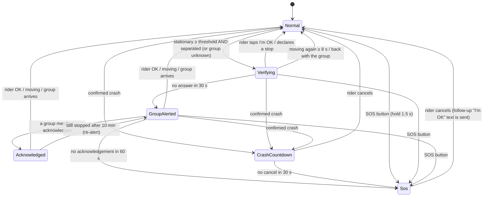

# ARMOR safety logic

Everything in this document is implemented in the plain-Kotlin `:core` module and covered by its tests. Nothing here
depends on Android, the network, or a learned model.

## Principles

1. **Deterministic.** Every emergency escalation is a fixed rule plus a timer. Given the same inputs and clock the
   engine produces byte-identical outputs (there is a test for this).
2. **Explainable.** Every state change writes a plain-English reason to the event log ("stationary 91s and separated
   from the group; asking the rider to confirm").
3. **AI can only reduce false alarms, never raise or suppress a real one.** See [Crash false-alarm filter](#crash-false-alarm-filter).
4. **Offline-first.** Nothing in the loop below needs internet. Group features degrade; the rider's own safety does not.
5. **Time is an input.** No class reads a clock. The host passes `nowMs`, so any ride can be replayed second by second.

## Escalation state machine



Defaults (`SafetyConfig`, all overridable):

| Setting | Default | Meaning |
|---|---|---|
| `groupStationaryMs` | 90 s | stopped this long while **separated** from the group → ask the rider |
| `soloStationaryMs` | 300 s | same, when group position is **unknown** (solo / offline); long enough to ride out a red light |
| `verifyTimeoutMs` | 30 s | time to answer "Are you OK?" |
| `groupAckTimeoutMs` | 60 s | time for the group to acknowledge before SOS |
| `crashCountdownMs` | 30 s | time to cancel after a crash before SOS |
| `responseCooldownMs` | 5 min | after "I'm OK", don't ask again for this long (crashes are never suppressed) |
| `intentionalStopGraceMs` | 15 min | a declared stop (Fuel, Break…) pauses the check |
| `ackExpiryMs` | 10 min | an acknowledged alert is re-raised if the rider is still stuck |
| `resumeMovingMs` | 8 s | sustained movement counts as "rider is on the move again" |

The check applies only when the rider is **not** with the group: a whole group stopped together at a fuel stop is
never questioned. If the rider is the only one with fresh data, the longer solo threshold is used.

## Who is "with the group"?

`ClusterAnalyzer` does single-linkage clustering: riders are chained together when each hop is shorter than

```
link = clamp(100 m + 12 s × median group speed, 150 m, 1500 m)
```

so a group at 90 km/h may spread over more road than one at a standstill. Riders not heard from for 60 s are
excluded (shown as "last seen"). The **unique largest** cluster is the main group; riders outside it are outliers.
If no cluster is strictly largest (two riders who drifted apart) nobody is "main" and everybody counts as separated —
the conservative reading. With no fresh peers the answer is `UNKNOWN`, not a guess.

## Is the rider stopped?

`StationaryDetector` uses an anchor-and-radius rule instead of raw speed (unreliable at walking pace): the rider is
stopped while fixes stay within `max(20 m, 1.5 × GPS accuracy)` of an anchor and ground speed is below 2 m/s. Leaving the
radius counts as movement only on **two consecutive fixes**, so one bad fix doesn't reset a stop. If GPS goes quiet for
10 s the answer is "unknown", never "stationary".

## Crash detection

```
accelerometer ≥ 4 g ──▶ open 1.5 s window ──▶ rotated? ──▶ CrashCandidate
                                                │
        gyro rotation ≥ 2 rad  OR  gravity direction moved ≥ 60° from the quiet baseline
```

The "quiet baseline" is a slow average of gravity taken only while the phone is calm (0.7–1.3 g), so the impact and
tumble never contaminate it. If the phone has no gyroscope, tilt alone is used. A candidate is not yet a crash:

### Crash false-alarm filter

After the candidate, the engine waits 4 s and looks at GPS speed before vs. after the impact. `CrashFilter` applies
fixed rules **in this order**:

1. No GPS speed before impact → **confirm** (can't rule a crash out).
2. Riding (≥ 5 m/s) and no GPS speed after → **confirm**.
3. Riding and speed fell to ≤ 50 % → **confirm** — the bike stopped. *Nothing can override this.*
4. Riding and speed still ≥ 70 % → **dismiss** — pothole, phone knocked off its mount, rider kept going.
5. Anything else is ambiguous. If a `CrashClassifier` is installed (the seam for a TensorFlow Lite model) **and**
   rates the false-alarm probability ≥ 0.9 → dismiss. Otherwise **confirm**.

So a model has a say only in the ambiguous middle ground (for example, a phone dropped while parked) and can only
ever dismiss. No model ships in this repository; the default behaviour with no classifier is to confirm, which costs the
rider one tap on "I'm OK".

## What happens on SOS

1. The raised alert is upgraded to `SOS` in the group.
2. An SMS goes to each emergency contact: who, why, and a `maps.google.com` link with the last fix, its accuracy and
   age. SMS needs cell coverage, **not internet**. It is plain ASCII and always fits a **single** 160-character message
   (a test checks the worst case), so a weak signal can't deliver the link separately from the text. Example:
   `ARMOR SOS: Arjun may have crashed and is not responding. Loc: https://maps.google.com/?q=12.971600,77.594600 (within 8 m, 3 s old)`
3. A failed send (no signal) is retried every 20 s, up to 3 attempts per contact, while the SOS stands.
4. A looping alarm at full volume plays and the phone vibrates (also helps bystanders find the rider).
5. If the rider cancels, a follow-up "has cancelled the earlier SOS and says they are OK" text is sent.

## Offline behaviour

| Capability | Online | Offline |
|---|---|---|
| Own GPS, stationary check, crash detection, alarms | ✅ | ✅ |
| SOS to emergency contacts (SMS) | ✅ | ✅ (needs cell signal) |
| Event log | ✅ stored + synced | ✅ stored, synced later |
| See other riders / group alert / acknowledge | ✅ | ⚠ last known positions go stale after 60 s; alerts queue (≤ 15 min) and are sent on reconnect |
| Group voice | mobile network | helmet intercom (if paired), otherwise none |

When peers go stale the engine falls back to the **solo** threshold instead of going silent.

## Failure modes worth knowing about

| Risk | Mitigation | Residual |
|---|---|---|
| False SOS after parking without ending the ride | solo threshold is 5 min; the check is loud; the SOS screen has Cancel and sends a follow-up text | still possible — **end the ride when you park** |
| Crash thresholds are wrong for a given phone/mount | sensitivity setting (3/4/5 g); every decision is logged with its numbers | **defaults are untuned** — calibrate with real rides |
| Phone has no gyroscope | tilt-only detection, logged at ride start | lower confidence |
| Android kills the service | foreground service + `START_STICKY` resume of a real ride | OEM battery savers can still interfere — see README |
| SMS refused / no signal | retries, status shown on the SOS screen, falls back to "call emergency services now" | no signal means no SMS |
| Clock jumps mid-ride | `RideClock` pins wall time once, then follows the monotonic clock | peers' clocks must be roughly right |

## Field-testing checklist (do this before relying on it)

- [ ] Mount the phone as you actually ride; log peak g over a normal ride including potholes/speed bumps — the 4 g
      default must sit clearly above it.
- [ ] Drop-test: phone dropped on a bed, on the floor, while parked → expect countdown on the floor, none on the bed.
- [ ] Ride with a second phone; stop one and confirm the check → group alert → acknowledge → SOS timings.
- [ ] Airplane mode with SMS: confirm the SOS text arrives with a correct link.
- [ ] Tunnel / dense tree cover: confirm "GPS lost" is shown and no false stationary alerts follow.
- [ ] A full-length ride: measure battery drain with the screen on and off.
