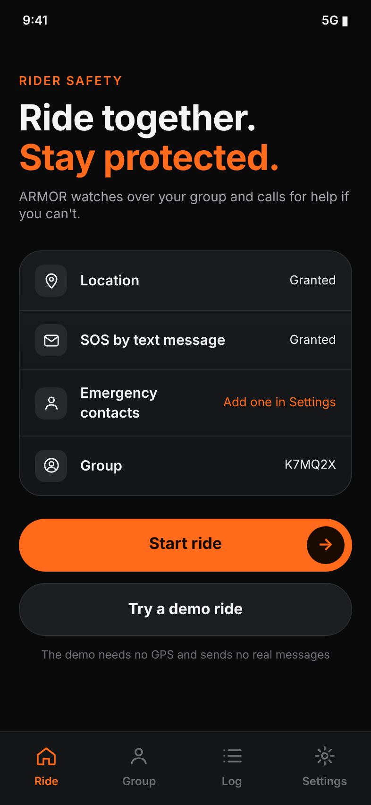
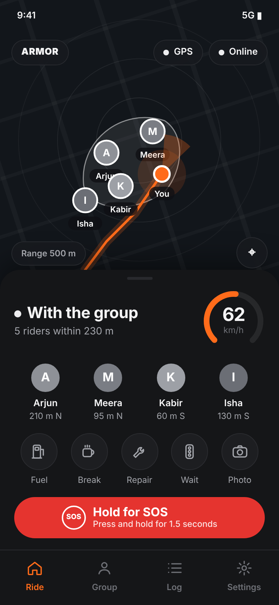
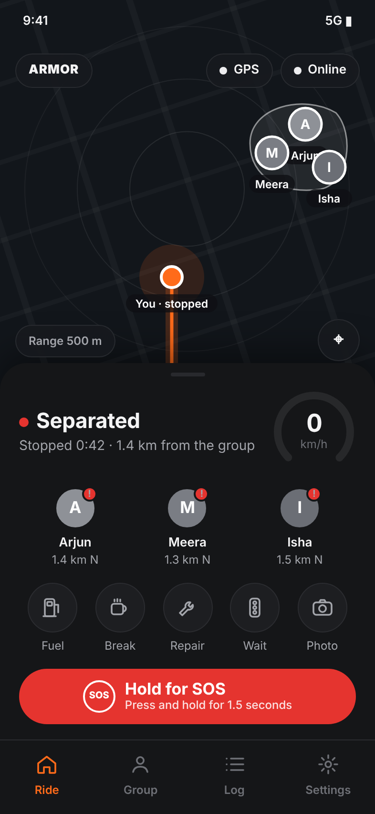
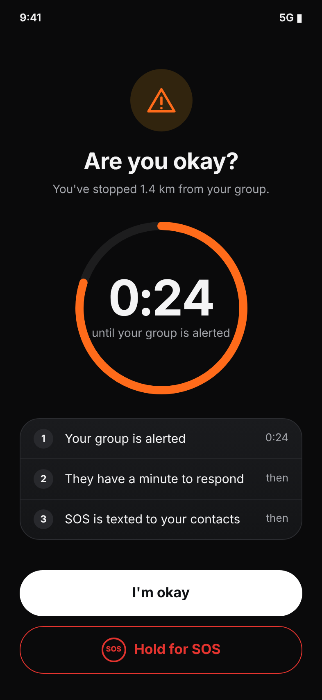
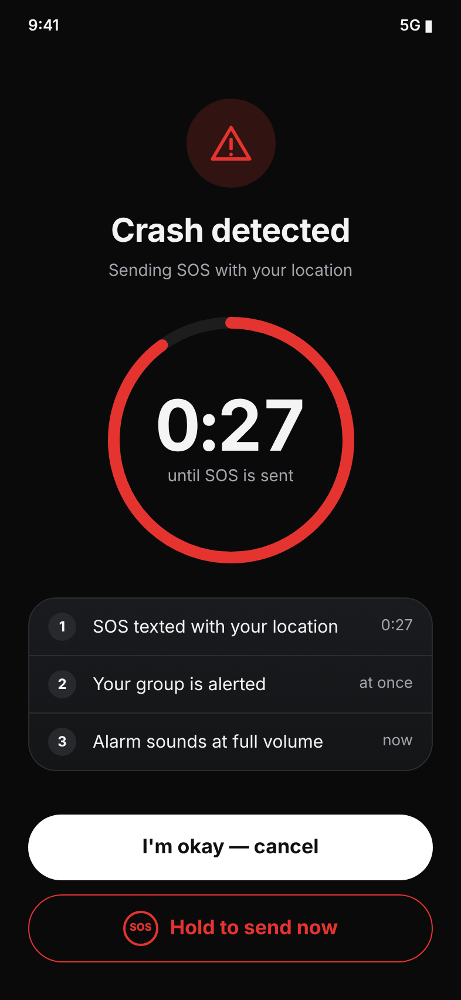
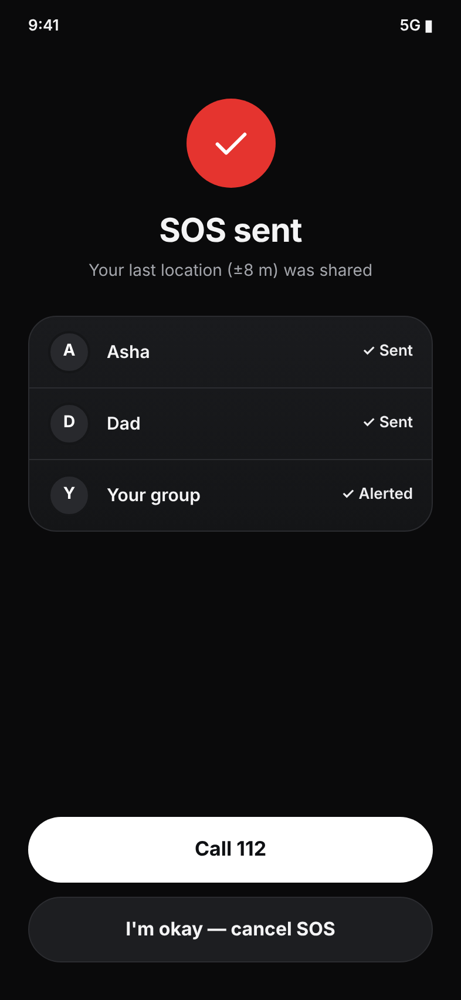
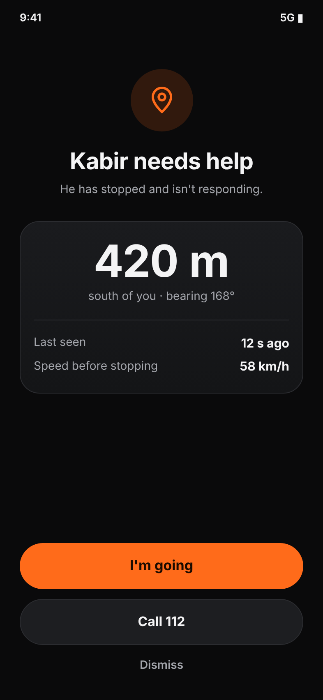
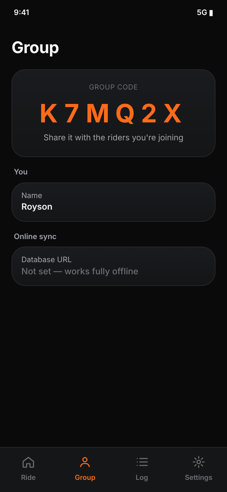
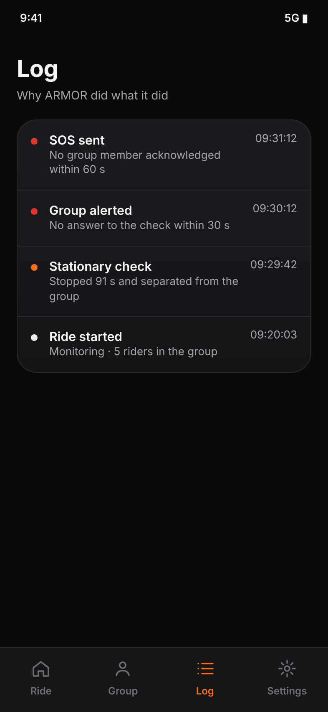
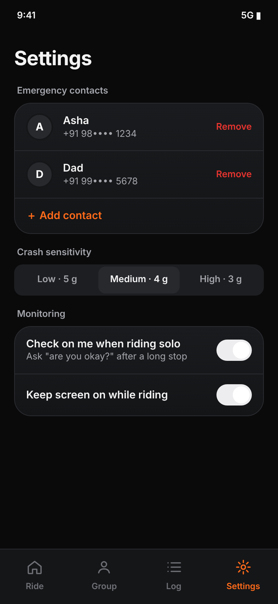

# ARMOR — UI guide

> **About these images.** They are **design previews**, rendered from HTML that mirrors the Jetpack Compose UI in
> `app/src/main/kotlin/com/armor/app/ui/` (same colours, wording, structure and proportions). They are **not captures
> from a device or emulator**: the Android build could not be run where this was written. Real spacing will differ a
> little. Tokens and components are documented in [DESIGN_SYSTEM.md](DESIGN_SYSTEM.md).

## Design direction

Premium, calm and legible, in the spirit of modern dark automotive and riding apps: near-black charcoal surfaces, soft
rounded cards, big confident type, a single orange accent, a dark map with a glowing orange route, and an orange arc
gauge. **Only four colours: orange, red, black and grey** (plus white for text). Orange means *brand and attention*,
red means *danger*, everything fine is white or grey. No glows, no sci-fi chrome, no emoji (all icons are monochrome
lines that take the app's colours).

A rider's phone is on a handlebar, so: large touch targets, very few controls per screen, and one obvious primary action.

## Ride tab

| Start | Riding with the group | Separated |
|---|---|---|
|  |  |  |

- **Start:** a two-tone headline ("Ride together. **Stay protected.**"), a checklist card (location, SOS by text, emergency contacts, group), an orange **Start ride** pill with an arrow, and a quieter **Try a demo ride**.
- **Map (full-bleed):** north-up and centred on you; works offline. Soft range rings over a faint street-grid texture, **your route as a glowing orange line**, you as the orange marker with a heading cone, other riders as grey avatars with a white ring, and the group's area as a soft white blob. A rider who has fallen away gets a red **!** badge. Chips float over the map for GPS and connection status, and **End**.
- **Bottom sheet:**
  - **Status:** "With the group · 5 riders within 230 m", or "Separated", "Riding solo", "<name> is on the way", with an **orange arc speed gauge** (full at 120 km/h).
  - **Riders:** avatar, name, distance and direction (or the status they've set).
  - **Quick status:** round line-icon buttons — Fuel, Break, Repair, Wait, Photo. Selected turns orange. Each pauses the "are you okay?" check for 15 minutes.
  - **Hold for SOS:** red pill; hold ~1.5 s while it charges.

## Alerts (full-screen)

| Are you okay? | Crash detected | SOS sent | A rider needs help |
|---|---|---|---|
|  |  |  |  |

Every alert follows the same pattern, so the rider never has to work out what to do: an icon, a plain title, the key number (a countdown ring, or a distance), a short **what happens next** list, then **one obvious primary action**.

- **Are you okay?** (orange): countdown to alerting the group. **I'm okay** is the big white button; SOS is a quiet red outline.
- **Crash detected** (red): countdown to SOS. **I'm okay — cancel**, or hold to send now.
- **SOS sent** (red): who was texted, **Call 112** (your configured number) and **I'm okay — cancel SOS**, which also texts a follow-up to your contacts.
- **A rider needs help** (orange, shown to *other* riders): a large distance and bearing. **I'm going** tells the group you're responding.

Alerts also light the lock screen, play a looping alarm at full volume and vibrate.

## Group, Log, Settings

| Group | Log | Settings |
|---|---|---|
|  |  |  |

Standard grouped lists: **Group** shows your code large, your name and the optional sync server; **Log** is every decision ARMOR made and *why*; **Settings** has emergency contacts, crash sensitivity (Low 5 g / Medium 4 g / High 3 g) and monitoring toggles.

## Demo ride

A demo ride adds a *Demo controls* panel (Stop my bike, Crash, Kabir stops, Everyone rides, Peers acknowledge) so every alert above can be walked through in under a minute.
